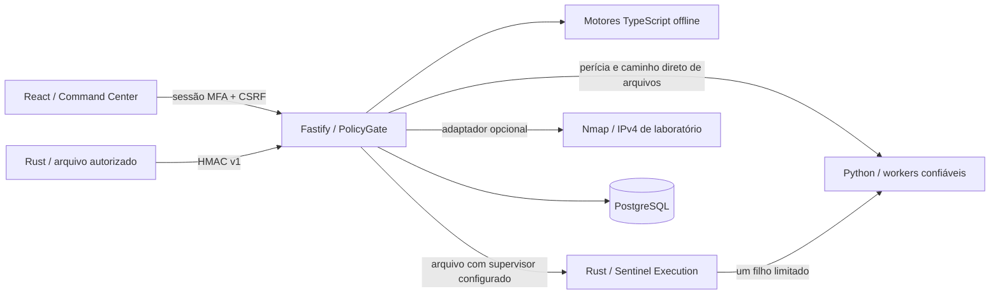

# Arquitetura consolidada — V11.0

02/11/2026. A referência vigente é V11, com requisitos anteriores compatíveis e complementos. A análise usa os registros e os arquivos tocados na continuidade; não declara nova auditoria integral.

O núcleo já usa React/TypeScript/Vite, Fastify e PostgreSQL com migrações e identidade runtime separada. PGlite é restrito ao desenvolvimento/teste. Há fundador único com MFA, recuperação, clientes como organizações, projetos, ativos, escopos, evidências cifradas e auditoria encadeada. A API local separa sessão humana de credencial HMAC do agente. Não há infraestrutura SaaS obrigatória.

O fluxo de evento sintético normaliza, persiste, correlaciona, gera alerta e incidente. Casos com notas/evidências, sensor de integridade conectado, análises de artefatos, auditoria OpenAPI, RiskGraph e correção reversível de cópia estão integrados. Workers Python analisam PCAP/PCAPNG/SQLite/plist e inspecionam ZIP/TAR/TAR.GZ em quarentena. Não há EDR, pentest completo, aquisição de disco/móvel ou self-healing operacional.

Evidências e relatórios pertencem à organização e ao ativo; o projeto é alcançado pelo vínculo do ativo. Persistência usa consultas parametrizadas. Originais são cifrados com chave externa ao banco; triggers protegem contra alterações pela identidade comum, sem promessa de WORM ou resistência a administrador do banco. O sensor transmite hash/metadados e não recebe comandos de execução.

A V11 prioriza Rust Core/runtime, preservando fundação, Authorization Manager, planos e importação existentes. O roadmap usa marcos0–5 e mapeia as fases anteriores; testes Windows não equivalem a homologação Debian. A matriz descreve recortes implementados e pendências, sem inferir prontidão comercial.

Novas capacidades devem ser ligadas ao inventário antes de serem apresentadas como disponíveis. Resultados atuais estão em VALIDATION_REPORT.md; documentos históricos continuam válidos onde não conflitarem com V11.

## Contratos e execução

APIs humanas `/api/*` exigem sessão; mutações exigem origem e CSRF. Escopos
vigentes por ativo autorizam análise/importação. O núcleo TypeScript não acessa
rede/disco/processos. Workers recebem argumentos fixos e ambiente reduzido,
sem shell. Seus relatórios devem comprovar hash e tamanho do original.

| Componente | Documentação / contrato | Limites |
|---|---|---|
| Agente | packages/endpoint-agent/README.md; /agent/v1/observations | HMAC, timestamp, nonce, revogação e deduplicação |
| Análise | docs/ANALISES.md; docs/API-SECURITY.md | 1 MiB, profundidade/nós limitados, sem resolução externa |
| Perícia | docs/FORENSE-WORKER.md; /api/forensics | 16 MiB, 60s, saída 4 MiB, um worker por banco |
| Arquivos | IMPORT_PIPELINE.md; /api/imports | ZIP/TAR/TAR.GZ,16MiB,45s, saída2MiB, quarentena sem extração |
| Supervisor | docs/RUST-ENGINES.md; stdin/JSON v1 | Um worker confiável, hash antes/depois, recibo e cancelamento por fechamento do pipe |
| Nmap | docs/ATTACKLAB.md; /api/lab/* | IPv4 cadastrado, 16 portas, 40s, concessão de execução com prazo |
| Casos/correção | REMEDIATION_WORKFLOW.md | Notas cifradas, mesmo ativo, aprovação e revisões da cópia |
| Grafo | docs/RISKGRAPH.md; /api/graph | 200 nós/500 relações; sem inferência de caminho explorável |

Jobs persistem em PostgreSQL: `running/completed/failed/interrupted`. Na
inicialização operacional, trabalhos em execução são marcados interrompidos e
auditados. Resultados tardios são recusados; originais e erros permanecem. Não há
fila central completa, pausa, cancelamento pelo painel ou reexecução automática.
O backend operacional deve executar como instância única neste recorte.

Migrações001–013 cobrem núcleo, operador/clientes, agentes, casos/correções,
análises, laboratório, perícia, importação, mandatos/manifestos e planos imutáveis.
Projeto é herdado do ativo e pode estar ausente na importação avulsa; planos
exigem projeto e revisão exata. static.scan e archive.inspect estão integrados;
demais perfis e contratos gerais continuam pendentes. O supervisor não requer
nova migração: recibo em report/auditoria, job mantém estados existentes.

Com Rust configurado, a API revalida autorização durante a inspeção e cancela
o filho quando detecta revogação/expiração. Polling250ms mais latência do banco
não é cancelamento atômico. Supervisor0.1.1 usa Job Object Windows e sinal de
morte do pai no Linux para o worker direto, com modo declarado/validado no recibo.
Árvores gerais, cotas de SO e fila ainda precisam de controles. A exceção FFI
restrita está justificada em docs/RUST-ENGINES.md; agente e parser preservados.

Processo separado e Python `-I` não são isolamento de sistema operacional.
VMs, redes restritas, execução de aplicações desconhecidas e ProofLab completo
dependem de implementação e validação próprias.
