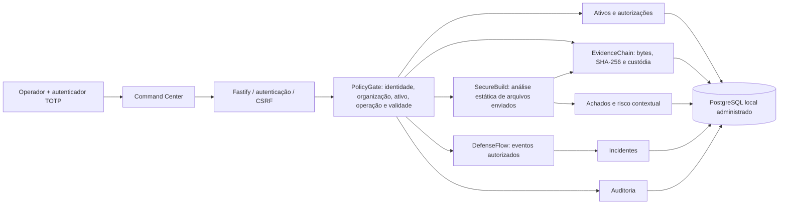

# I.See Sentinel — arquitetura da fundação 0.1

Data: 23/10/2026. Especificação vigente: Elite Edition V6.5. Edição: Private Operator Edition, um único operador fundador. Alvo principal: Debian 13 Stable + KDE Plasma, PostgreSQL local administrado e arquitetura híbrida. Este documento descreve a primeira fatia executável e a evolução pretendida. O inventário de módulos e a matriz de aceitação distinguem esses dois estados. Não há certificação, validação independente, operação comercial ou proteção absoluta demonstrada.

## Diagnóstico observado

O ambiente acessível é Windows 10 Pro, versão 10.0.19045. Debian e Arch não foram executados nesta sessão. A migração planejada para Debian não foi realizada. A chamada de inventário do WSL devolveu ajuda; isso não comprova uma distribuição Linux instalada nem KVM utilizável.

| Recurso | Observação da sessão |
|---|---|
| CPU | Intel Core i7-7700HQ, 4 núcleos, 8 processadores lógicos |
| RAM | 16.658.020 KiB total; 6.071.800 KiB livre no instante da coleta |
| GPU | GTX 1050 e Intel HD 630; driver reportou aproximadamente 4 GiB e 1 GiB, respectivamente. Isso não é uma medição física confiável de VRAM. |
| Disco C | 239.345.352.704 bytes total; 81.516.568.576 bytes livres no instante da coleta |
| Virtualização | Firmware reportou suporte habilitado; disponibilidade operacional no Linux não verificada |
| Runtime | Node 24.21.0, npm 11.19.0, Python 3.11.9, Git 2.56.0.windows.2 |
| PostgreSQL | Serviço `postgresql-x64-18` encontrado em execução; `psql` fora do PATH. Não foram acessados dados nem alterada sua configuração. |

O perfil comporta a fundação local e análises pequenas; não foi medido para SOC contínuo, imagens forenses grandes, múltiplas VMs ou LLMs locais. O banco principal V6.5 é PostgreSQL local administrado com URL explícita. O PostgreSQL existente do usuário permanece preservado; testes nativos usam instância temporária separada. PGlite exige modo `embedded` explícito e serve apenas a desenvolvimento/testes. O script `scripts/diagnose-linux.sh` fornece a próxima coleta segura no Debian real; Ubuntu é compatibilidade adicional planejada. Os números acima são observações históricas, não reservas disponíveis ao aplicativo. SSD Kingston A400 de 480 GB e HD externo de 1 TB foram declarados pelo operador; o volume C não confirma a capacidade ou o layout do disco físico.

## Repositório e fronteiras

```text
apps/api/                 Fastify, autenticação, rotas, persistência e CLI
apps/api/migrations/      Esquema SQL versionado
apps/api/test/            Testes da API e persistência
apps/web/                 React + TypeScript + Vite + Tailwind
packages/core/            Contratos, PolicyGate, regras e cálculos determinísticos
packages/core/test/       Testes das engines sem rede externa
scripts/                  Diagnóstico e inventário de dependências
ops/                      Exemplo systemd para homologação Linux
docs/                     Arquitetura, decisões, operação e rastreabilidade
```



A interface nunca é a fronteira de autorização. Todo recurso é identificado no backend e associado ao contexto de organização selecionado na sessão do fundador. A mudança de contexto precisa de autenticação, CSRF e auditoria; o identificador enviado pelo navegador não concede acesso por si só. Clientes são registros de organizações/projetos, sem contas no painel. Dados de arquivos e eventos são conteúdo não confiável, sem autoridade para alterar política, escolher comando de sistema ou consultar a rede. A edição inicial executa um único processo de aplicação; os seis planos são fronteiras lógicas, não seis serviços distribuídos.

| Plano | Responsabilidade | Fatia inicial | Próxima fronteira física |
|---|---|---|---|
| Control Plane | Operador fundador, organizações/projetos, ativos, políticas, escopos e auditoria | Sessões, MFA, contexto privado de organização e autorização temporária por ativo | Identidades de serviços; múltiplos operadores somente em evolução posterior |
| Security Data Plane | Receber, normalizar, armazenar e consultar eventos | Eventos com versão de esquema e persistência SQL | Coletores com autenticação, quotas e canal separado |
| Analysis Plane | Configuração, dependências, código, forense e rede | SecureBuild estático limitado e risco explicável | Workers Python/Node isolados, sem privilégios e com saída controlada |
| Defense Plane | Detecção, contenção, correção e recuperação | Correlação inicial e representação honesta das barreiras | Playbooks com aprovação, limites de impacto e rollback comprovado |
| Laboratory Plane | Cyber range, cenários Red/Purple e análise dinâmica | Apenas classificação de ambiente `lab`; sem execução ofensiva | VMs QEMU/KVM em rede isolada; gestão não implementada |
| Intelligence Plane | Explicações, priorização e propostas assistidas | Sem provedor LLM ou ferramentas de IA conectados | Propostas tipadas avaliadas pelo mesmo PolicyGate e por revisão humana |

## Fluxos disponíveis e modelo de dados

A fatia de auditoria conecta ativo → autorização com validade → arquivos enviados → job → análise → achados → evidência → avaliação de risco → relatório. O texto de arquivo é analisado como dado. Uma análise estática de padrões não equivale a SAST completo, exploração confirmada, DAST nem auditoria de aplicação em funcionamento.

A fatia de eventos recebe eventos de fonte declarada e versão conhecida. A evolução V6.3 separou regras, alertas persistidos e incidentes. A confiança na fonte não é demonstrada por aceitar o JSON; eventos sintéticos são identificados. Há protótipo Rust offline sob consentimento para observar SHA-256 de um arquivo escolhido, acompanhado de validador Python; não há serviço de agente instalado, coleta de rede ou monitoramento contínuo automático. `AgentObservation v1` é distinto de `SecurityEvent v1` e ainda não é ingerido pela API. Adaptadores Linux journald/audit e Windows Event Log/ETW, canal autenticado, identidade de serviço e integração PolicyGate permanecem planejados. O agente não deverá executar comandos arbitrários recebidos da central.

As migrações são a fonte de verdade do modelo físico. A versão inicial contém `organizations`, `users`, `sessions`, `login_attempts`, `assets`, `authorizations`, `jobs`, `scans`, `evidence`, `findings`, `security_events`, `incidents` e `audit_events`. As chaves compostas de organização/recurso reduzem ligações cruzadas; as consultas também exigem filtro de organização. Não se afirma RLS configurada.

O vocabulário de eventos evolui para `Asset → SecurityEvent → Detection → Finding → Evidence → RiskAssessment → Incident → ResponseAction → Remediation → Verification → Report`. O evento persistido inicial tem UUID, organização, ativo, tipo, fonte, timestamps de ocorrência/recepção, `schema_version=1` e payload validado. Evoluções incompatíveis exigem nova versão. Não confundir timestamps declarados pelo remetente com timestamps recebidos pelo servidor.

Entidades ainda conceituais ou em expansão: Roles/Permissions dinâmicas, Engagements/contratos completos, Scopes normalizados, Services, Technologies, DetectionRules configuráveis, Vulnerabilities correlacionadas, EvidenceTransfers próprios, RiskAssessments e RiskRelationships normalizados, DefensePolicies, SecurityBarriers e BarrierEvaluations persistidos, ResponseActions, RemediationPlans, PatchCandidates, DeploymentRecords, VerificationResults, RecoveryActions, Exercises, SimulationResults, ThreatIndicators, Reports persistidos e Integrations. A adaptação V6.3 acrescenta projetos, organização na sessão, regra versionada e alertas; seu estado de teste consta na matriz. Papéis internos de compatibilidade, escopo em `authorizations`, resultado de análise em JSON e custódia em auditoria não significam entidades comerciais completas.

## Persistência, consistência e recuperação

PostgreSQL via `pg`, instalado e administrado localmente, é o padrão V6.5; iniciar sem `DATABASE_URL` nesse modo deve falhar com orientação clara. PGlite é uma implementação PostgreSQL em WebAssembly útil somente para desenvolvimento/testes explícitos com `SENTINEL_DATABASE_MODE=embedded`. A compatibilidade de SQL não substitui homologação de concorrência, durabilidade, permissões e backup no PostgreSQL real. Essa distinção segue a [documentação oficial de PGlite](https://pglite.dev/docs/about).

Evidências pequenas residem no SQL, cifradas pela aplicação, junto aos metadados, para permitir gravação transacional sem janela entre arquivo e registro. O SHA-256 deve sempre ser calculado dos bytes originais recuperados. Hash e cadeia de auditoria ajudam a detectar alteração; não demonstram, sozinhos, autoria, timestamp confiável, custódia jurídica ou resistência a administrador do banco comprometido. Armazenamento externo, ancoragem independente e retenção imutável são evolução futura.

Jobs persistem estado e resultado, mas o executor inicial é local e síncrono/limitado. Não há distribuição, leasing, retries automáticos, execução exatamente uma vez ou retomada transparente. Uma interrupção precisa ficar explícita; reexecução deve gerar nova rastreabilidade. Backups confiáveis dependem do exercício de restauração documentado em `OPERACAO.md`.

## Política de autonomia

Leitura e análise exigem autorização do ativo, mesmo no laboratório. Operações fora da lista conhecida são negadas. Mudança de produção, execução de ferramenta externa, bloqueio, isolamento, patch ou recuperação não têm executor habilitado nesta entrega. Quando forem adicionados, exigirão avaliação determinística de escopo, impacto, prazo e autorização, além de aprovação específica ou política emergencial pré-aprovada. Um modelo de IA não poderá definir suas próprias permissões.

## Evolução incremental

1. Homologar a fundação no Debian 13/KDE e PostgreSQL dedicado; exercitar backup, restauração e perda de processo.
2. Melhorar identidade: WebAuthn, reautenticação e rotação de chaves; homologar a recuperação CLI já implementada. Administração de múltiplos operadores pertence à expansão futura, não à edição privada inicial.
3. Isolar workers e ingestão; criar fila SQL com leases, limites e idempotência; adicionar conectores de leitura revisados.
4. Implementar SecureFix/SafeDeploy em laboratório com diff, testes, aprovação, health check e rollback; depois AutoDefense/Self-Healing.
5. Executar exercícios Purple Team e forenses reproduzíveis antes de ampliar operação ou comercializar.

IdentityGuard, CloudShield e ExposureMap ampliam análise de identidades, postura cloud e exposição; suas primeiras integrações serão de leitura e escopo explícito. Threat Hunting e Vulnerability Management dependerão de consultas, histórico, estados de triagem e fontes verificadas. Validation Lab mede falsos positivos/negativos, recuperação, performance e segurança dos agentes. Esses módulos estão previstos, sem alegação de EDR/XDR operacional.

Nenhuma etapa habilita cobrança, exposição pública ou promessas de cobertura sem evidência.

## Arquitetura híbrida V6.5

Os seis planos funcionais coexistem com três camadas de execução. A camada A é o Debian nativo: API, Command Center, PostgreSQL, Node, Rust, Python, motores e systemd quando apropriado. A camada B é Podman rootless opcional para workers leves e ambientes descartáveis. A camada C é Kali em QEMU/KVM/libvirt/virt-manager para laboratório de sistema completo, desligada quando não utilizada. Essas camadas não estão instaladas ou homologadas nesta sessão Windows.

Podman futuro exige procedência e digest de imagem, CPU/RAM limitadas, capabilities mínimas, nenhum `--privileged`, montagens estritas e preferencialmente somente leitura, segredos fora da imagem e rede restrita. Contêiner compartilha kernel com o host; chroot não é isolamento de segurança. Experimentos perigosos exigem isolamento apropriado e análise específica; nem uma VM comum garante contenção absoluta. Consulte `FASES-V6.5.md` para os gates de implantação e fontes.

Firebase e Supabase não integram backend, autenticação, banco ou telemetria interna. `External Backend Security Adapters` é uma fronteira futura de leitura autorizada, posterior à validação do SecureBuild genérico. Chave pública de cliente não é automaticamente um segredo; achado deve considerar permissões reais. Nenhum desses adaptadores foi implementado ou instalado.
